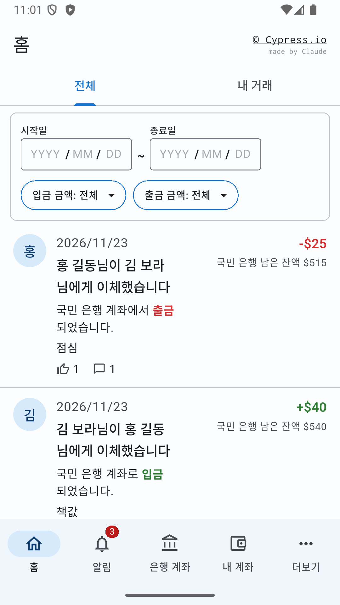

# Cypress Realworld For Personal Portfolio Mobile

내 웹 포트폴리오 프로젝트의 결제 앱을 **네이티브 안드로이드(Flutter)** 로 다시 만든 앱입니다. [cypress-realworld-for-portfolio](https://github.com/wonderwall1995/cypress-realworld-for-portfolio)의 **모바일 짝**이고, 그 웹 프로젝트는 Cypress.io의 [Cypress Real World App](https://github.com/cypress-io/cypress-realworld-app)을 개인적으로 포크한 것입니다.

이 앱은 **QA 포트폴리오용 데모 앱**입니다. 테스트하기 좋게 만들었습니다. 테스트가 만지는 모든 위젯에는 고정된 id가 있고, 이름은 웹의 `data-testid`와 같습니다. 테스트 설계는 따로 진행합니다.

| 홈 | 앱 소개 |
| :---: | --- |
|  | **홈 화면** (화면 글자는 한국어입니다).  - **전체 / 내 거래** 탭 - **날짜 / 입금 금액 / 출금 금액** 필터 - 각 줄: 날짜, 누가 누구에게 이체했는지(또는 외부 입금), 내 은행 계좌의 입금·출금, 금액과 남은 잔액, 좋아요, 댓글 - 헤더 오른쪽: **© Cypress.io**(원본 저장소 링크)와 **made by Claude** - 아래 막대: 홈, 알림(안 읽은 개수), 은행 계좌, 내 계좌, 그리고 **더보기** 메뉴(설정, 앱 정보, 로그아웃) |

## 휴대폰에서 테스트 시연

로그인 화면의 **시연**에서 000~009 중 하나를 고르면, 기존 E2E의 화면·API 흐름을 Flutter 앱 안에서 재현합니다. PC나 Appium 연결은 필요 없으며, 앱이 사용하는 API 서버에는 연결되어 있어야 합니다. 001의 계좌 60개 한도처럼 긴 단계도 포함합니다.

- 앱과 대화상자 위의 왼쪽 버튼은 테스트 재선택, 가운데 버튼은 일시정지·재개, 오른쪽 **중지**는 로그아웃 후 로그인 복귀입니다. 재선택도 현재 실행과 세션을 정리한 뒤 엽니다.
- 선택 목록에는 `000-auth.spec.ts`부터 `009-login-logout.spec.ts`까지 실제 파일명을 표시합니다. 정상 완료되면 중지 버튼과 같은 정리·로그아웃을 자동 수행하고 로그인 화면으로 돌아갑니다. 실패하면 확인할 수 있도록 해당 단계에 멈춥니다.
- 앱 화면을 터치하거나 앱이 백그라운드로 가면 다음 동작이 멈춥니다. 이미 보낸 서버 요청은 마칠 수 있으며, 자동으로 재개하지 않습니다. 직접 다른 화면으로 이동했다면 중지하거나 테스트를 다시 선택할 수 있습니다.
- 실행마다 지어낸 사용자와 계좌를 만듭니다. 완료·중지 시 해당 실행의 계좌를 정리하고 별도 API 세션도 로그아웃합니다. 사용자와 거래 내역은 서버에 남고, 연결이 끊기면 계좌 정리도 실패할 수 있습니다.
- fixture는 웹의 `tests/e2e/fixture/random*.ts`와 같은 생성 규칙을 사용합니다. 영문 이름 6자, 한글 ID 3자, `010-숫자4자리-숫자4자리`, 숫자 비밀번호 4자리, 가상 은행 32곳과 계좌 번호 9~12자리입니다. 설정 변경값은 영문 이름 8자와 `@example.com`, 댓글은 한글 8자이며, 009의 비밀번호는 `Aa`·`Bb` 접두사를 붙입니다. 정식 실행의 번호별 fixture를 조회하거나 재사용하지 않습니다.
- TypeScript 테스트 파일 자체를 APK에서 실행하는 방식은 아닙니다. `lib/features/simulation`의 대응 시나리오를 사용하므로 E2E가 바뀌면 함께 갱신해야 합니다. 앱 재설치·재시작, PC DB 직접 조회, 웹에만 있는 단계, 정식 테스트 결과 기록은 수행하지 않습니다. 시연 완료는 정식 E2E 통과를 뜻하지 않습니다. DB 스냅샷은 포함하지 않습니다.

`pnpm app:test`는 실행 제어, 화면 조작, 대화상자 위 컨트롤과 로그아웃, 메모리 API에 연결한 10개 시나리오를 검증합니다. 메모리 API 검증은 실제 서버·휴대폰 검증을 대신하지 않습니다.

## License Compliance

This app is the mobile counterpart of a personal fork of the [Cypress Real World App](https://github.com/cypress-io/cypress-realworld-app) by Cypress.io, distributed under the [MIT License](LICENSE).

- **The original copyright belongs entirely to the Cypress.io team.** The original MIT License text and the copyright notice (Copyright (c) 2020 Cypress.io) are retained in [LICENSE](LICENSE).
- This app is used **solely for non-commercial purposes** (personal learning and portfolio). It is unofficial, and it is not affiliated with, endorsed by, or sponsored by Cypress.io. It is not published to any app store.
- The app name contains "Cypress" only to credit the original project. Cypress logos and trademark images are not used.
- My modifications are shared under the same MIT License.
- The software is provided "as is", without warranty of any kind; see [LICENSE](LICENSE).
- Third-party packages keep their own licenses. They are listed inside the app (**… menu → 앱 정보 → 오픈소스 라이선스**).

## Web - App 자동화 테스트 예제 프로젝트

Cypress.io 팀 웹 데모 대상, Web과 App 자동화 테스트 구현 시연

| 구분 | 링크 |
|---|---|
| Web Repo | https://github.com/wonderwall1995/cypress-realworld-for-portfolio |
| App Repo (이 저장소) | https://github.com/wonderwall1995/cypress-realworld-for-portfolio-mobile |
| Web 배포 링크 | https://demo.hwk-resume.web.chickenkiller.com/ |
| 이력서 | https://resume-hwk.ltwayne0.workers.dev/main |

### 문제 프레임

실질적인 목표는 **자동화 테스트 코드의 구조**를 자신이 어떻게 다루는지 보이고 싶었습니다.
원래 존재하던 **Cypress.io 측에서 MIT 라이선스로 배포 중인 웹 데모를 개량.**
기능 개선을 Web Repo에서 마치고, Web에서의 기능을 따와 Flutter Native 앱으로도 구현했습니다.

### 설계

테스트 코드는 배포된 Web에서 실제 어떻게 실행되는지 **Playwright 실행을 모방**하여 진행합니다.
배포된 웹에서 개별 테스트 코드에 대한 조회와 테스트 진행에 대한 시연을 보는 것이 가능합니다.
시연은 data-testid 색인된 UI 대상으로 자동화 테스트가 진행되며, 동시에 API 테스트 코드를 통한 검증을 혼합합니다. UI/UX 자동화 코드가 변경에 취약한 점이나, API 테스트 코드가 렌더링되는 UI 대상으로는 검증이 미비할 수 있는 점을 **UI/UX 및 API 자동화 테스트 방식이 혼합된 테스트 코드를 하나로 작성**함으로써 보완하는 시도입니다.

App에서의 자동화 테스트는 Appium + Wdio(드라이버) 방식으로 구현되었으며,
Web 측의 데모 제품과 기능이 대부분 일치합니다.
테스트에 사용되는 값(Fixture)을 사용하는 면에서는 Prisma + PostgreSQL 측에 **자동화 테스트를 위한 DB 내, Fixture를 생성할 때 이를 기록**하고 테스트 코드에 특정되는 Row 값을 Fixture로서 삽입하는 방식으로 Web과 App에서의 자동화 테스트 시나리오가 깨지지 않게끔 시도했습니다.

Web에서의 Playwright 사용으로 크게 세 개의 테스트 코드를 나눠둔 상태입니다.
하나는 .ts 확장자를 가지는 '공용 테스트', 같은 .ts 확장자를 가지는 'API 테스트' 그리고 실제 Playwright CLI 명령어로 실행시키는 .spec.ts 테스트 코드로 나뉩니다.
개별 .spec.ts 코드는 **Playwright가 가지는 병렬적 실행이 가능하다는 장점을 활용**, .spec.ts **테스트 코드 간 병목이나 종속성을 가급적 배제한 상태**로 테스트를 실행합니다.

### 아쉬운 점

앞서 거론된 **공용 테스트** 코드, **API 테스트** 코드의 경우에도
실패와 성공에 대해서 따로 세심하게 기록을 하면 좋겠다는 생각도 있습니다.
조금 더 해볼 수 있다면 Grafana와 Test Record가 든 스키마 혹은 테이블 측면을 연결.
**개별 .spec 테스트 코드 이외의 코드들도 실제 성공 및 실패 여부를 그려내는 것**도 해보면 좋지 않을까,
그런 아쉬움이 있습니다. - **현재 과다 스펙이라 여겨진 구상**입니다.

### 회고 (KPT)

#### Keep
- 재직 중에 경험치 못한 API 테스트 코드의 구현 방식을 본 프로젝트에서 학습할 수 있었습니다.
- UI/UX 및 API 자동화 테스트 가지는 단점을 상호 보완하는 시도가 좋았다고 판단됩니다.

#### Problem
1. Mocking이나 데이터 흐름 테스트에 대한 요소도 익혀 나가야 할 것 같습니다.
2. Jmeter와 같은 테스트 도구로 비기능적인 부분을 테스트하면 좋겠다는 생각이 있습니다.

#### Try
- App에는 Web과 동일 기능을 가지는 것 이외, 독자적인 기능을 추후에 넣는 것도 필요할 것 같습니다.
- 복잡한 테스트를 적용하기엔 아직 웹 앱 데모의 개발 내용이 많지 않아 추후에 시도해보고자 합니다.

## License

This project is licensed under the terms of the [MIT license](LICENSE).
