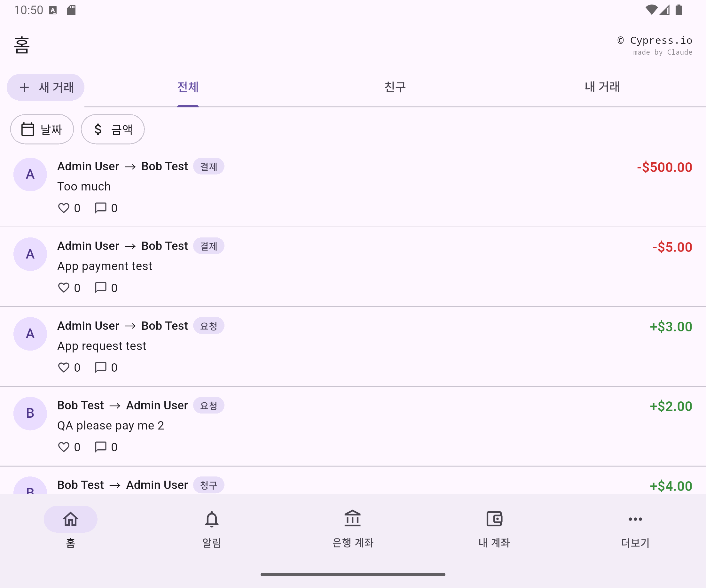

# Cypress Realworld For Personal Portfolio Mobile

A native Android (Flutter) rewrite of the payment app from my web portfolio project. It is the **mobile counterpart** of [cypress-realworld-for-portfolio](https://github.com/wonderwall1995/cypress-realworld-for-portfolio), which is a personal fork of the [Cypress Real World App](https://github.com/cypress-io/cypress-realworld-app) by Cypress.io.

This is a **demo app for a QA portfolio**: it is built so that it can be tested well (every widget that a test touches has a stable id, using the same names as the web `data-testid`). The test design itself is done separately.

| Home | About the app |
| :---: | --- |
|  | **Home screen** (the UI text is Korean).  - **새 거래** (new transaction) button, and the tabs **전체 / 친구 / 내 거래** (everyone / friends / mine) - **날짜 / 금액** filter chips (date range, amount range) - Each row: who paid or asked whom, the amount, likes and comments - Bottom bar: Home, Notifications (with an unread number), Bank Accounts, My Account, and a **…** menu (settings, app info, sign out) |

## How it relates to the web project

- **Same server.** The app talks to the same Express API and PostgreSQL database as the web app. It is a separate UI, not a WebView.
- **Same names.** Widget ids follow the web `data-testid` names where the web has the same element.
- **The web repository is the source of truth.** Changes needed on the server side are requested there, not made here.

## Features and status

**Built and checked on an Android emulator against the real server**

- Sign in (with "remember me"), sign up, sign out
- First-time setup (create a bank account), and the bank accounts list (add, delete)
- Transaction lists (everyone, friends, mine) with scrolling pages, pull to refresh, and date and amount filters
- Transaction detail, new payment or request (3 steps), accept or reject a request
- Likes, comments, and notifications with an unread number
- My Account (balance), deposit and withdraw between a bank account and the balance, and a transfer history
- Settings (name, email, phone number, and the default privacy of new transactions)
- An app info page with the license notices

**Not done yet**

- End-to-end tests with WebdriverIO and Appium
- iOS and real devices have **not** been run or checked

## License Compliance

This app is the mobile counterpart of a personal fork of the [Cypress Real World App](https://github.com/cypress-io/cypress-realworld-app) by Cypress.io, distributed under the [MIT License](LICENSE).

- **The original copyright belongs entirely to the Cypress.io team.** The original MIT License text and the copyright notice (Copyright (c) 2020 Cypress.io) are retained in [LICENSE](LICENSE).
- This app is used **solely for non-commercial purposes** (personal learning and portfolio). It is unofficial, and it is not affiliated with, endorsed by, or sponsored by Cypress.io. It is not published to any app store.
- The app name contains "Cypress" only to credit the original project. Cypress logos and trademark images are not used.
- My modifications are shared under the same MIT License.
- The software is provided "as is", without warranty of any kind; see [LICENSE](LICENSE).
- Third-party packages keep their own licenses. They are listed inside the app (**… menu → 앱 정보 → 오픈소스 라이선스**).

**한국어 안내**

이 앱은 Cypress.io의 [Cypress Real World App](https://github.com/cypress-io/cypress-realworld-app)을 개인적으로 포크한 웹 프로젝트의 모바일 짝이며, [MIT 라이선스](LICENSE)를 따릅니다.

- **원저작권은 모두 Cypress.io 팀에게 있습니다.** 원본 MIT 라이선스 전문과 저작권 고지(Copyright (c) 2020 Cypress.io)를 [LICENSE](LICENSE)에 그대로 유지합니다.
- **오직 비상업적 목적**(개인 학습, 포트폴리오)으로만 사용하며, 비공식 앱입니다. Cypress.io와 제휴·보증·후원 관계가 없습니다. 앱 마켓에는 배포하지 않습니다.
- 앱 이름의 "Cypress"는 원본 프로젝트의 출처를 밝히기 위한 것입니다. Cypress 로고와 상표 이미지는 사용하지 않습니다.
- 제가 수정한 부분도 동일하게 MIT 라이선스로 공유합니다.
- 소프트웨어는 어떠한 보증도 없이 "있는 그대로" 제공됩니다. 자세한 내용은 [LICENSE](LICENSE)를 참고하세요.
- 사용한 서드파티 패키지는 각자의 라이선스를 따르며, 앱 안(**… 메뉴 → 앱 정보 → 오픈소스 라이선스**)에서 볼 수 있습니다.

## License

This project is licensed under the terms of the [MIT license](LICENSE).
